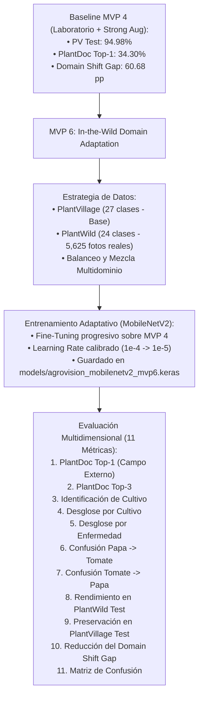

# AgroVision MVP 6 — Plan Experimental: In-the-Wild Domain Adaptation

## 🎯 Objetivo General
Evaluar experimentalmente si la incorporación de **`5,625` fotografías de campo real procedentes de PlantWild** (24 clases fitosanitarias compatibles) combinadas con el dataset base de laboratorio **PlantVillage (27 clases)** permite reducir sustancialmente el *Domain Shift*, mejorando el diagnóstico fitosanitario y la identificación botánica en el benchmark externo **PlantDoc (100% ciego)**, sin provocar olvido catastrófico en laboratorio.

---

## 1. Cadena de Decisión Experimental y Modelos a Comparar



---

## 2. Matriz de Modelos a Contrastar

| Dimensión | **MVP 2 (Baseline Inicial)** | **MVP 4 (Baseline de Referencia)** | **MVP 6 (In-the-Wild Adaptation)** |
|---|---|---|---|
| **Datos de Entrenamiento** | PlantVillage (Suave) | PlantVillage (Strong Aug) | **PlantVillage (27 cls) + PlantWild (24 cls)** |
| **Fotos Reales en Entrenamiento** | `0` fotos | `0` fotos | **`~4,500` fotos reales (Train/Val)** |
| **PlantVillage Test (Control)** | `91.28%` | `94.98%` | **Objetivo: $\ge 92.0\%$ (Preservación)** |
| **PlantDoc Top-1 (Campo Ciego)**| `33.14%` | `34.30%` | **Objetivo: Superar récord de 34.30%** |
| **PlantDoc Top-3** | `53.49%` | `56.40%` | **Objetivo: $> 56.40\%$** |
| **Identificación de Cultivo** | `69.19%` | `70.35%` | **Objetivo: $> 70.35\%$** |
| **Domain Shift Gap** | `58.14 pp` | `60.68 pp` | **Objetivo: Reducción significativa ($< 55\text{ pp}$)** |

> 🚨 **Regla Inquebrantable de Integridad:** PlantDoc permanece **100% CIEGO** (cero imágenes, cero etiquetas, cero crops). PlantSeg queda desacoplado para la futura fase de segmentación foliar.

---

## 3. Protocolo de Mezcla y Balanceo de Datasets

Para evitar que las 24 clases con datos de PlantWild dominen o desequilibren a las 3 clases exclusivas de PlantVillage (*Sarampión negro en Vid, Arañuela roja en Tomate y Mancha diana en Tomate*):

1. **Construcción del Dataset Híbrido (`src/data_prep_mvp6.py`):**
   * **Conjunto de Entrenamiento:**
     * Para las 24 clases coincidentes: Mezcla de imágenes de PlantVillage Train + imágenes de PlantWild Train (`~3,900` fotos de campo).
     * Para las 3 clases exclusivas: Imágenes de PlantVillage Train con sobremuestreo/aumentación para mantener equilibrio de masa probabilística.
   * **Conjunto de Validación:**
     * PlantVillage Validation + PlantWild Validation (`~550` fotos de campo).
2. **Estrategia de Entrenamiento (`src/train_mvp6.py`):**
   * Partir de los pesos convolucionales optimizados de **MVP 4** (`models/agrovision_mobilenetv2_mvp4.keras`).
   * Fine-Tuning en 2 etapas:
     * *Etapa 1 (Adaptación de Cabeza):* Congelar base convolucional, `lr=1e-4`, 8 épocas.
     * *Etapa 2 (Alineación Multidominio):* Descongelar las últimas 30 capas, `lr=1e-5`, 12 épocas con `EarlyStopping(patience=3)`.
   * Guardado en `models/agrovision_mobilenetv2_mvp6.keras`.

---

## 4. Batería de Evaluación Multidimensional (11 Métricas)

El script `src/evaluate_mvp6.py` y `src/analyze_errors_mvp6.py` medirán:
1. **Top-1 Patológico en PlantDoc (Campo Ciego)**
2. **Top-3 Patológico en PlantDoc**
3. **Identificación de Especie Botánica en PlantDoc**
4. **Exactitud Diagnóstica Desglosada por los 6 Cultivos**
5. **Rendimiento por Patología Individual**
6. **Tracking de Solanáceas (`Papa -> Tomate` y `Tomate -> Papa`)**
7. **Rendimiento en PlantWild Test (3,677 imágenes *in-the-wild*)**
8. **Preservación en PlantVillage Test (5,104 imágenes de laboratorio)**
9. **Cálculo de la Brecha de Dominio (*Domain Shift Gap*):**
   $$\text{Gap}_{\text{MVP 6}} = \text{Top1}_{\text{PV Test}} - \text{Top1}_{\text{PlantDoc}} \quad \text{vs} \quad \mathbf{60.68\text{ pp (MVP 4)}}$$
10. **Matriz de Confusión Completa de 27 Clases**
11. **Auditoría Forense Diferencial (Fixed vs Robust vs Persistent vs Regressions)**

---

## 5. Entregables y Scripts

```text
src/
├── data_prep_mvp6.py        # Generador del dataset híbrido PlantVillage + PlantWild
├── train_mvp6.py            # Fine-Tuning de adaptación de dominio sobre MVP 4
├── evaluate_mvp6.py         # Evaluación 3-Way (MVP 2 vs MVP 4 vs MVP 6) en PV, PW y PlantDoc
└── analyze_errors_mvp6.py   # Auditoría de las 11 métricas, Solanáceas y matrices de confusión

results/
├── mvp6_comparison.json     # Registro estructurado de las 11 dimensiones
├── mvp6_comparison_bars.png # Gráfica comparativa multidimensional
├── mvp6_confusion_matrix.png# Matriz de confusión sobre PlantDoc
└── mvp6_report.md           # Informe formal para la defensa de tesis
```
